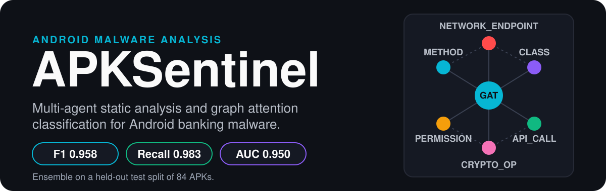
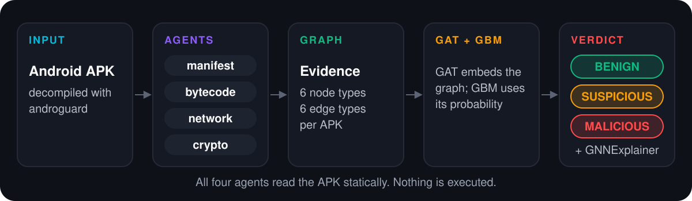

<p align="center">
  
</p>

APKSentinel reads an Android APK, extracts evidence with four static analysis agents, turns that evidence into a graph, and labels the app as BENIGN, SUSPICIOUS, or MALICIOUS. Each prediction comes with an explanation of which parts of the graph drove the decision.

## How it works

<p align="center">
  
</p>

- **Agents** (`agents/`) run on the decompiled APK:
  - `manifest`: permissions with risk weights, components, and accessibility service use.
  - `bytecode`: calls to sensitive Android APIs, listed in `config/sensitive_apis.json`.
  - `network`: URLs, IP addresses, and encoded URLs found in string constants.
  - `crypto`: cryptographic API use, hard-coded keys, and SSL pinning checks.
- **Graph** (`graph/`): evidence becomes nodes of six types (`METHOD`, `CLASS`, `PERMISSION`, `API_CALL`, `NETWORK_ENDPOINT`, `CRYPTO_OP`) joined by six edge types.
- **Model** (`model/`): a two-layer Graph Attention Network (`GATConv`, 4 heads) with mean and max pooling. An ensemble (gradient boosting, XGBoost, random forest) then uses the GAT probability as one of its inputs. The ensemble that wins on validation is the one shipped.
- **Verdict** (`config/settings.py`): risk below 0.3 is BENIGN, below 0.6 is SUSPICIOUS, and anything higher is MALICIOUS.
- **Explanation** (`explain/`): GNNExplainer highlights the most influential nodes and edges, and `explain/mitre_mapping.py` maps permissions to MITRE ATT&CK techniques.

The analysis is static. Nothing in an APK is executed.

## Results

Measured on a held-out test split of 84 APKs. The 554 analyzed APKs were split 387 / 83 / 84 for training, validation, and testing, with seed 42.

| Model | Accuracy | F1 | Precision | Recall | AUC-ROC |
| --- | ---: | ---: | ---: | ---: | ---: |
| GAT only | 0.857 | 0.897 | 0.897 | 0.897 | 0.922 |
| Ensemble (GBM with GAT probability) | 0.940 | 0.958 | 0.934 | 0.983 | 0.950 |

These numbers come from one split (`demo/models/results.json` and `demo/models/ensemble_results.json`). On 84 test APKs, a single misclassification moves accuracy by about 1.2 points, so treat the figures as indicative, not as a benchmark.

## Quick start: run the demo

The demo ships with three analyzed sample APKs and trained models, so it runs without the raw dataset.

```bash
pip install -r requirements.txt
streamlit run demo/app.py
```

Open the URL Streamlit prints, choose a sample from the forensic archive or upload an APK, and run the analysis.

## Reproduce the pipeline

The APK binaries are not in this repository (`*.apk` is git-ignored). To fetch them, put your AndroZoo key in a `.env` file as `ANDROZOO_API_KEY=...`.

```bash
python -m pipeline.download --input data/labels/labels.csv --output data/raw --limit 10
python -m pipeline.process --input data/raw --labels data/labels/labels.csv
python -m model.train
python -m model.ensemble
```

`pipeline.process` writes evidence and graphs to `data/evidence/` and `data/graphs/`. `model.train` saves the GAT to `data/models/best_gat.pt`, and `model.ensemble` reads that checkpoint to build the ensemble.

## Project layout

```text
agents/     static analysis agents (manifest, bytecode, network, crypto)
graph/      evidence-to-graph builder, node and edge schema, features
model/      GAT, dataset, training, and ensemble
explain/    GNNExplainer wrapper, agent attribution, MITRE mapping
pipeline/   download, process, and dataset building
config/     settings, risk thresholds, sensitive API list
demo/       Streamlit app, sample APKs, trained models and results
data/labels labels for the 1,000 APKs (500 benign, 500 malware)
tests/      synthetic pipeline test and real-APK test
```

## Limitations

- **Static analysis only.** Packed, encrypted, or heavily obfuscated code can hide the strings and API calls the agents look for.
- **Small evaluation.** The numbers above come from one split with 84 test APKs. They have not been cross-validated or tested on an independent dataset.
- **Dataset not included.** Reproducing training requires downloading APKs from AndroZoo with your own key.
- **No license yet.** This repository does not include a license file, so the terms of use are not yet defined.
